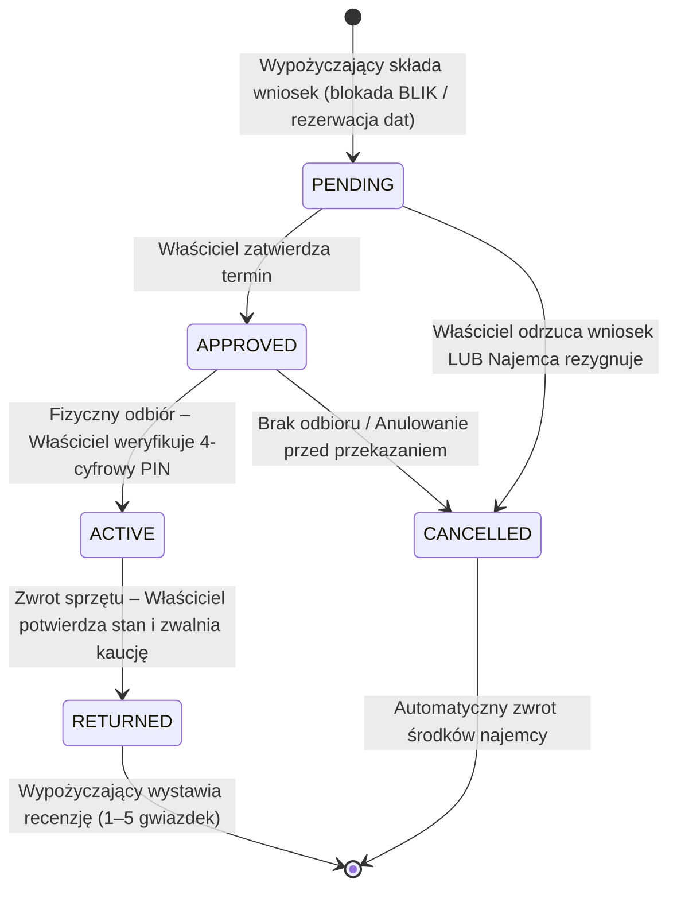

# Barter App – Sąsiedzka Platforma Wynajmu Sprzętu i Narzędzi P2P

[](https://nextjs.org/)
[](https://react.dev/)
[](https://www.typescriptlang.org/)
[](https://tailwindcss.com/)
[](https://www.prisma.io/)
[](https://www.docker.com/)
[](https://www.typescriptlang.org/)

**Barter App** to platforma internetowa gospodarki współdzielenia (Sharing Economy / Peer-to-Peer), zaprojektowana z myślą o lokalnych społecznościach miejskich (pilotowo: dzielnice Rzeszowa). Aplikacja umożliwia bezpieczne, transparentne i opłacalne wypożyczanie sprzętu domowego, remontowo-budowlanego i ogrodniczego pomiędzy sąsiadami.

---

## 🎯 Kluczowe Założenia i Wartość Biznesowa

Większość specjalistycznych narzędzi (wiertarki udarowe, myjki ciśnieniowe, glebogryzarki, szlifierki do gipsu) jest używana sporadycznie i przez ponad 95% czasu leży bezczynnie w piwnicach i garażach. **Barter App** rozwiązuje ten problem:

1. **Ekonomia sąsiedzka (Hyperlocal P2P):**  
   Użytkownicy wyszukują sprzęt w swojej bezpośredniej okolicy (np. Nowe Miasto, Drabinianka, Baranówka, Osiedle Akademickie), minimalizując koszty logistyki i wspierając integrację sąsiedzką.
2. **3-etapowy proces wypożyczenia:**  
   $$\text{Wystawienie oferty} \longrightarrow \text{Rezerwacja terminu i kaucja} \longrightarrow \text{Fizyczny odbiór z kodem PIN}$$
3. **Transparentny model prowizyjny (15%):**  
   - Właściciel otrzymuje **100% ustalonej stawki dobowej** ($\text{ownerAmount} = \text{dni} \times \text{stawka}$).
   - Platforma pobiera **15% opłaty serwisowej** na utrzymanie infrastruktury ($\text{commissionAmount} = \text{dni} \times \text{stawka} \times 0.15$).
   - Opcjonalna **kaucja zwrotna** ($\text{depositAmount}$) zabezpieczająca stan techniczny sprzętu.
   - Łączna kwota do zapłaty: $\text{totalPaid} = \text{ownerAmount} + \text{commissionAmount} + \text{depositAmount}$.
4. **Wielopoziomowe bezpieczeństwo i prywatność:**  
   - **4-cyfrowy kod PIN (`pickupPin`):** Generowany kryptograficznie dla każdego zatwierdzonego wniosku. Właściciel fizycznie weryfikuje PIN w aplikacji w momencie przekazania narzędzia.
   - **Ochrona danych adresowych:** Dokładny adres właściciela (`exactAddress`) oraz numer telefonu są ukryte do momentu zatwierdzenia wniosku przez właściciela. W katalogu widoczna jest wyłącznie dzielnica/osiedle.
   - **System reputacji 1:1:** Oceny (1–5 gwiazdek) i recenzje są powiązane ściśle z unikalnym identyfikatorem zrealizowanego wypożyczenia (`rentalRequestId`), eliminując fałszywe opinie.

---

## 🔄 Maszyna Stanów Wypożyczenia (Rental Lifecycle)

Cykl życia każdej rezerwacji jest kontrolowany przez deterministyczną maszynę stanów z atomowymi transakcjami bazodanowymi:



---

## 🏗️ Architektura i Stack Technologiczny

System został zaprojektowany w nowoczesnym modelu hybrydowym **Next.js App Router** (React Server Components + Server Actions), łącząc renderowanie po stronie serwera z optymalną interaktywnością:

| Warstwa | Technologia | Wersja | Zastosowanie w projekcie |
| :--- | :--- | :--- | :--- |
| **Frontend Framework** | Next.js (App Router, Turbopack) | `16.4.3` | Server Components, dynamiczny streaming, Partial Prerendering |
| **Biblioteka UI** | React / React DOM | `19.3.0` | Hooki `useActionState`, `useTransition`, interaktywne modale |
| **Język** | TypeScript | `^5.x` | 100% Strict Mode, zero `any`, pełne bezpieczeństwo typów DTO |
| **Stylowanie** | Tailwind CSS v4 | `v4.x` | Ciemny motyw industrialny (`stone-950`, `orange-600`), CSS variables |
| **Ikony** | Lucide React | `^1.61.0` | Semantyczne ikony narzędziowe, stany i kontrolki |
| **ORM** | Prisma | `^5.22.0` | Mapowanie relacji, silnik zapytań, wersjonowane migracje SQL |
| **Baza danych** | SQLite | `dev.db` | Lekka, lokalna baza danych z trwałym mapowaniem wolumenu |
| **Uwierzytelnianie** | JWT (`jose`) + `bcryptjs` | `HS256` | Bezpieczne ciasteczka sesyjne `HttpOnly`, ochrona Edge Middleware |
| **Walidacja** | Zod | `^4.x` | Deklaratywna walidacja wejścia w formularzach i Server Actions |
| **Konteneryzacja** | Docker & Docker Compose | Multi-stage | Izolacja zależności, spójne środowisko deweloperskie i produkcyjne |

---

## 📁 Struktura Projektu

```text
barter-app/
├── app/
│   ├── (auth)/
│   │   ├── login/page.tsx           # Logowanie z szybkimi kontami demonstracyjnymi
│   │   └── register/page.tsx        # Rejestracja użytkownika z automatyczną sesją
│   ├── actions/
│   │   ├── auth.actions.ts          # Server Actions: sesje, logowanie, rejestracja
│   │   ├── item.actions.ts          # Server Actions: dodawanie, edycja i widoczność sprzętu
│   │   └── rental.actions.ts        # Server Actions: maszyna stanów, PIN, kaucje, recenzje
│   ├── dashboard/page.tsx           # Pulpit użytkownika RSC (role Wypożyczający / Właściciel)
│   ├── items/
│   │   ├── [id]/page.tsx            # Widok szczegółów oferty (galeria, kalendarz, opinie)
│   │   ├── [id]/edit/page.tsx       # Edycja ogłoszenia z autoryzacją 403 Forbidden
│   │   └── new/page.tsx             # 3-krokowy kreator wystawienia nowego sprzętu
│   ├── layout.tsx                   # Główny layout (Nawigacja sesyjna, stopka, theme lock)
│   └── page.tsx                     # Katalog główny – wyszukiwarka i filtry URL searchParams
├── components/
│   ├── dashboard/                   # Moduły pulpitu (zarządzanie narzędziami, obsługa wniosków)
│   ├── items/                       # Galeria Lightbox, kalendarz rezerwacji, filtry katalogowe
│   ├── layout/                      # Pasek nawigacji z sesją oraz stopka z odznakami zaufania
│   ├── rentals/                     # Modal oceny z gwiazdkami, odznaki statusu maszyny stanów
│   └── ui/                          # Reużywalne komponenty Atomic Design (Button, Input, Card, Modal, Badge)
├── docs/
│   └── ARCHITECTURE.md              # Kompletna architektura techniczna, diagramy ERD i sekwencji
├── lib/
│   ├── auth.ts                      # Obsługa JWT w ciasteczkach HttpOnly i requireAuth()
│   ├── prisma.ts                    # Singleton klienta Prisma Client
│   └── queries/items.queries.ts     # Zoptymalizowane zapytania katalogowe z bezpieczną projekcją
├── prisma/
│   ├── migrations/                  # Wersjonowane migracje SQL
│   ├── schema.prisma                # Relacyjny schemat danych (User, Category, Item, RentalRequest, Review)
│   └── seed.ts                      # Idempotentny skrypt zasilający (8 kategorii, 111 ofert, recenzje)
├── types/
│   └── domain.ts                    # Ścisłe typy domenowe, stałe i czyste funkcje pomocnicze
├── docker-compose.yml               # Środowisko deweloperskie z natychmiastowym live-reloadem
├── docker-compose.prod.yml          # Zoptymalizowany build produkcyjny standalone
├── Dockerfile.dev                   # Obraz deweloperski (Node 22 Alpine, musl libc, openssl)
├── CHANGELOG.md                     # Rejestr wydań zgodny ze specyfikacją Keep a Changelog
└── CONTRIBUTING.md                  # Standardy inżynieryjne, procedury migracji i weryfikacji
```

---

## 🚀 Instrukcja Uruchomienia (Quick Start)

Do uruchomienia projektu wymagany jest wyłącznie zainstalowany **Docker** oraz **Docker Compose**. Nie ma konieczności instalowania Node.js ani pakietów npm na maszynie hosta.

### Jedna komenda do startu:

```bash
docker compose up --build
```

Aplikacja zostanie automatycznie zbudowana i uruchomiona pod adresem:  
👉 **[http://localhost:3001](http://localhost:3001)**

> [!NOTE]  
> Port aplikacji to **`3001`**, co zapobiega częstym kolizjom z innymi lokalnymi serwisami działającymi na domyślnym porcie 3000.

### Zatrzymanie kontenera:
```bash
docker compose down
```

---

## 🗄️ Zarządzanie Bazą Danych i Narzędzia Deweloperskie

Baza danych SQLite (`prisma/dev.db`) jest trwale powiązana z systemem plików hosta. Restart kontenera nie powoduje utraty danych.

| Operacja | Polecenie w terminalu |
| :--- | :--- |
| **Zasilenie bazy danych (Seed 111 ofert):** | `docker compose exec app npx prisma db seed` |
| **Wdrożenie migracji:** | `docker compose exec app npx prisma migrate deploy` |
| **Tworzenie nowej migracji:** | `docker compose exec app npx prisma migrate dev --name <nazwa>` |
| **Weryfikacja spójności schematu:** | `docker compose exec app npx prisma validate` |
| **Podgląd w Prisma Studio:** | `docker compose exec app npx prisma studio --port 5555 --browser none` |

*Po uruchomieniu Prisma Studio interfejs bazy danych dostępny jest pod adresem `http://localhost:5555`.*

---

## 👥 Konta Demonstracyjne do Ewaluacji (Test Accounts)

W celu natychmiastowego przetestowania ścieżki rezerwacji, weryfikacji kodu PIN oraz podziału ról (Właściciel $\leftrightarrow$ Wypożyczający), baza danych została zasilona następującymi kontami testowymi.

Wszystkie konta testowe posiadają to samo hasło: **`haslo1234`**

| Adres E-mail | Rola i Profil demonstracyjny | Dzielnica (Rzeszów) | Dostępne zasoby |
| :--- | :--- | :--- | :--- |
| **`marek.kowalski@barter.local`** | **Właściciel:** Elektronarzędzia profesjonalne | Osiedle Akademickie | 28 narzędzi (DeWalt, Bosch, Makita), oczekujące wnioski |
| **`anna.nowak@barter.local`** | **Właściciel:** Sprzęt czyszczący i ogrodowy | Osiedle Słoneczne | 28 urządzeń (Kärcher, Stihl, AL-KO), aktywne wynajmy |
| **`piotr.wisniewski@barter.local`** | **Właściciel:** Maszyny warsztatowe i budowlane | Drabinianka | 28 maszyn (Scheppach, Stanley, Flex), historia zwrotów |
| **`jan.kowalski@example.com`** | **Wypożyczający:** Aktywny najemca sprzętu | Nowe Miasto | Złożone rezerwacje, kod PIN do okazania, historia opinii |

> [!TIP]  
> Formularz logowania na stronie [`/login`](http://localhost:3001/login) posiada kafelki szybkiego logowania – kliknięcie wybranego kafelka natychmiast uzupełnia dane konta.

---

## 🧪 Weryfikacja Jakości i Testy Integralności

Projekt spełnia rygorystyczne standardy inżynieryjne:

```bash
# 1. Walidacja schematu relacyjnego Prisma
node node_modules/prisma/build/index.js validate

# 2. Weryfikacja spójności migracji bazodanowych
node node_modules/prisma/build/index.js migrate status

# 3. Kompilacja TypeScript (100% Strict Type-Safety, brak błędów typowania)
node node_modules/typescript/bin/tsc --noEmit

# 4. Sprawdzenie poprawności deklaracji Docker Compose
docker compose config
```

---

## 📜 Licencja i Nota Akademicka

Projekt zrealizowany w ramach pracy inżynierskiej / projektu akademickiego dedykowanego lokalnej gospodarce współdzielenia i platformom P2P.  
Kod źródłowy udostępniany na licencji **MIT**.
