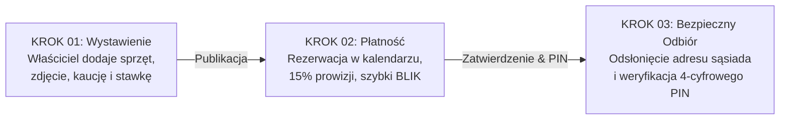

# Barter – Platforma Wynajmu Sąsiedzkiego P2P 🔄

[](https://nextjs.org/)
[](https://react.dev/)
[](https://tailwindcss.com/)
[](https://www.prisma.io/)
[](https://www.typescriptlang.org/)
[](https://www.docker.com/)
[](https://www.typescriptlang.org/)

> **"Ekonomia współdzielenia w Twoim sąsiedztwie"**  
> Serwis internetowy typu Peer-to-Peer (P2P) do bezpiecznego wypożyczania sprzętu remontowego, ogrodniczego i domowego między mieszkańcami rzeszowskich osiedli, oparty na **skalowalnym 15% modelu prowizyjnym**.

---

## 👥 Zespół Projektowy i Podział Ról

| Członek Zespołu | Rola | Zakres Odpowiedzialności i Wkład |
| :--- | :--- | :--- |
| **Agata Mróz** | **Product Manager (PM)** | • **Strategia produktu:** Kierowanie rozwojem platformy internetowej i priorytetyzacja roadmapy.<br>• **Model prowizyjny:** Nadzór nad monetyzacją transakcji (**15% opłaty serwisowej**).<br>• **Koordynacja i finanse:** Zarządzanie harmonogramem wdrożenia w Rzeszowie oraz analiza wskaźników ekonomicznych (ROI, NPV, BEP). |
| **Kamil Śliwa** | **Intern / Lead Full-Stack Dev** | • **Vibe coding & Inżynieria:** Implementacja architektury full-stack (Next.js 16 App Router, React 19, Tailwind v4, Prisma, Docker).<br>• **Katalog i oferty:** Przygotowanie taksonomii **8 kategorii sprzętu** oraz bazy **111 realistycznych ofert** z Unsplash.<br>• **Jakość i Bezpieczeństwo:** Testy ścieżki rezerwacji użytkownika, maszyna stanów najmu, weryfikacja PIN oraz ochrona danych. |

---

## 💡 Kluczowy Proces (Aplikacja w 3 Krokach)



1. **KROK 01 – Wystawienie sprzętu:** Właściciel dodaje zdjęcie, stan techniczny, kaucję zwrotną i stawkę dobową (3-krokowy kreator z dynamicznym kalkulatorem zysku).
2. **KROK 02 – Płatność z prowizją:** Wypożyczający wybiera dostępne dni w interaktywnym kalendarzu bez kolizji terminów i opłaca rezerwację online (15% prowizji platformy doliczanej do stawki bazowej).
3. **KROK 03 – Odbiór sprzętu:** System dopiero po opłaceniu odsłania dokładny adres sąsiada i generuje 4-cyfrowy kod PIN; fizyczne wydanie sprzętu wymaga potwierdzenia PIN-u przez właściciela (challenge-response).

---

## 📊 Wskaźniki Finansowe i Analiza Rentowności (3-letnia Projekcja)

Model biznesowy opiera się na **15% opłacie serwisowej** pobieranej od wartości każdego zrealizowanego wypożyczenia.

| Wskaźnik / Metryka | Rok 1 (Pilotaż Rzeszów) | Rok 2 (Skalowanie Podkarpacie) | Rok 3 (Ekspansja Regionalna) |
| :--- | :---: | :---: | :---: |
| **Liczba wypożyczeń (transakcji)** | 1 200 | 4 800 | 14 000 |
| **Średnia wartość koszyka (GMV)** | 120 PLN | 120 PLN | 120 PLN |
| **Łączny obrót platformy (GMV)** | 144 000 PLN | 576 000 PLN | 1 680 000 PLN |
| **Przychód platformy (15% prowizji)** | **21 600 PLN** | **86 400 PLN** | **252 000 PLN** |
| **Koszty operacyjne (OPEX chmura/marketing)** | 8 500 PLN | 24 000 PLN | 68 000 PLN |
| **Zysk netto** | **13 100 PLN** | **62 400 PLN** | **184 000 PLN** |

* **Nakład początkowy (CAPEX):** **18 000 PLN** (infrastruktura, domeny, pilotaż osiedlowy).
* **3-letni zwrot z inwestycji (ROI):** **1330%** (skumulowany zysk netto 259 500 PLN / nakład początkowy 18 000 PLN).
* **Wartość bieżąca netto (NPV przy stopie r = 10%):** **+182 400 PLN** (inwestycja wysoce dochodowa).
* **Próg rentowności (BEP):** **48 wypożyczeń miesięcznie** pokrywa stałe koszty serwerów i utrzymania platformy.

---

## 🛠️ Twarde Metryki Inżynierskie z Repozytorium

Stan implementacji w kodzie źródłowym (`main`):

* **Modele relacyjne Prisma (5):** `User`, `Category`, `Item`, `RentalRequest`, `Review`.
* **Enumy domenowe TypeScript (2):** `ToolCondition` (4 stany), `RentalStatus` (5 stanów maszyny wypożyczeń).
* **Kategorie sprzętu w katalogu (8):** Elektronarzędzia, Sprzęt czyszczący, Ogród i Działka, Budowa i Remont, Sprzęt warsztatowy, Malowanie i Wykończenie, Przyrządy pomiarowe, Transport i Magazyn.
* **Zweryfikowane oferty sprzętu (111):** 100% działających fotografii z Unsplash (HTTP 200 OK) przypisanych do 4 domyślnych użytkowników w dzielnicach Rzeszowa.
* **Server Actions w Next.js (13):** Modularnie podzielone na autoryzację, zarządzanie ofertami i maszynę stanów wynajmu.
* **Komponenty UI w Atomic Design (18):** `ui/` (5), `items/` (5), `dashboard/` (4), `layout/` (2), `rentals/` (2).
* **Dedykowane ekrany / trasy w App Router (7):** `/`, `/login`, `/register`, `/dashboard`, `/items/new`, `/items/[id]`, `/items/[id]/edit`.
* **Chronione grupy tras (3):** Ochrona w `middleware.ts` przy użyciu ciasteczek `HttpOnly` JWT (`jose`).
* **Zgodność jakościowa:** `npx prisma validate` (0 błędów), `npx tsc --noEmit` (0 błędów), zautomatyzowane testy domenowe (4/4 PASS).

---

## 🔑 Konta Testowe do Weryfikacji (Seed Data)

Hasło dla wszystkich kont demonstracyjnych: **`haslo1234`**

| Użytkownik | Adres E-mail | Rola w Prezentacji | Lokalizacja w Rzeszowie |
| :--- | :--- | :--- | :--- |
| **Marek Kowalski** | `marek.kowalski@barter.local` | Właściciel sprzętu (28 ofert) | Osiedle Akademickie / Politechnika |
| **Anna Nowak** | `anna.nowak@barter.local` | Wypożyczająca / Właścicielka (28 ofert) | Osiedle Słoneczne / Rejon Lwowskiej |
| **Piotr Wiśniewski** | `piotr.wisniewski@barter.local` | Właściciel sprzętu (28 ofert) | Osiedle Drabinianka / Żwirownia |
| **Jan Kowalski** | `jan.kowalski@example.com` | Najemca / Właściciel (27 ofert) | Nowe Miasto / Millenium Hall |

---

## 🐳 Uruchamianie w Dockerze (Szybki Start)

Aplikacja została w pełni skonteneryzowana przy użyciu standardowego **Docker Compose**. Do uruchomienia projektu na dowolnej maszynie nie jest wymagana lokalna instalacja Node.js na hoście.

### 1. Szybki start (Jedna komenda)

```bash
docker compose up --build
```

lub przy użyciu skryptu npm:

```bash
npm run docker:build
```

Po uruchomieniu aplikacja jest dostępna pod adresem:  
👉 **[http://localhost:3001](http://localhost:3001)**

### 2. Uruchomienie testów domenowych

```bash
npm run docker:test
# lub: docker compose exec app npm test
```

### 3. Zarządzanie bazą danych i migracjami w Dockerze

- **Wypełnienie bazy danymi testowymi (111 ofert, 8 kategorii, opinie):**
  ```bash
  npm run docker:prisma:seed
  ```
- **Weryfikacja schematu Prisma:**
  ```bash
  docker compose exec app npx prisma validate
  ```
- **Podgląd bazy w Prisma Studio:**
  ```bash
  docker compose exec app npx prisma studio --port 5555 --browser none
  ```
- **Zatrzymanie kontenera:**
  ```bash
  docker compose down
  ```

---

## 📚 Pełna Dokumentacja i Materiały Prezentacyjne

- [GOOGLE_SLIDES_PROMPT.md](GOOGLE_SLIDES_PROMPT.md) – Kompletny, gotowy prompt dla Google Slides / Gemini do wygenerowania 6-slajdowego Pitch Decku (z 1-slajdowym Business Model Canvas),
- [Project_context.md](Project_context.md) – Tożsamość projektu, architektura, zmienne środowiskowe i specyfikacja,
- [AI_WORKFLOW.md](AI_WORKFLOW.md) – Standardy inżynieryjne, procedury weryfikacji i instalacji,
- [docs/ARCHITECTURE.md](docs/ARCHITECTURE.md) – Diagramy Mermaid, ERD bazy danych, maszyna stanów wypożyczeń,
- [CHANGELOG_AI.md](CHANGELOG_AI.md) – Rejestr zmian architektonicznych wprowadzonych przez AI.

---

## 🛠️ Tradycyjne uruchamianie lokalne bez Dockera (opcjonalne)

Jeżeli wolisz uruchomić aplikację bezpośrednio na maszynie hosta z Node.js:

```bash
npm install
npx prisma generate
npx prisma migrate deploy
npm run test
npm run dev
```
