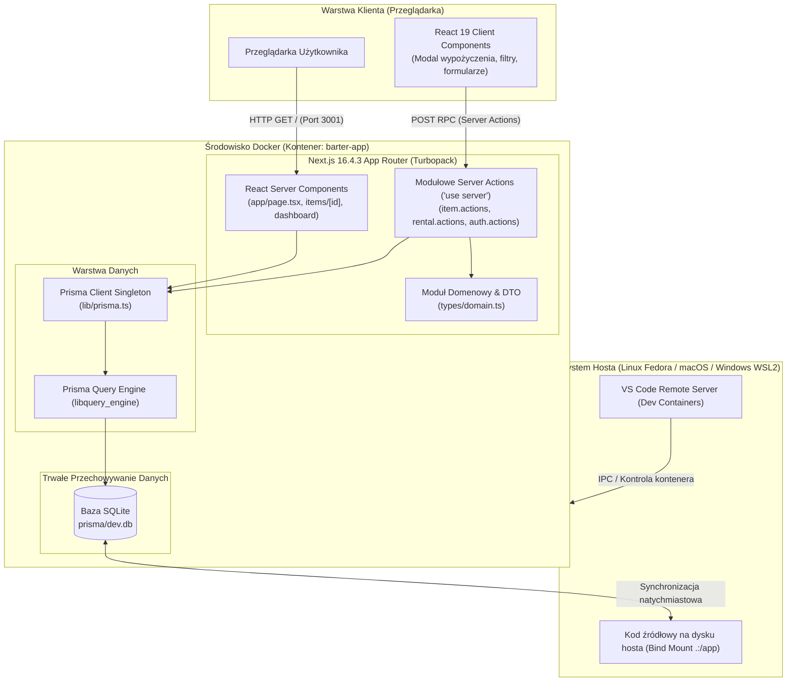
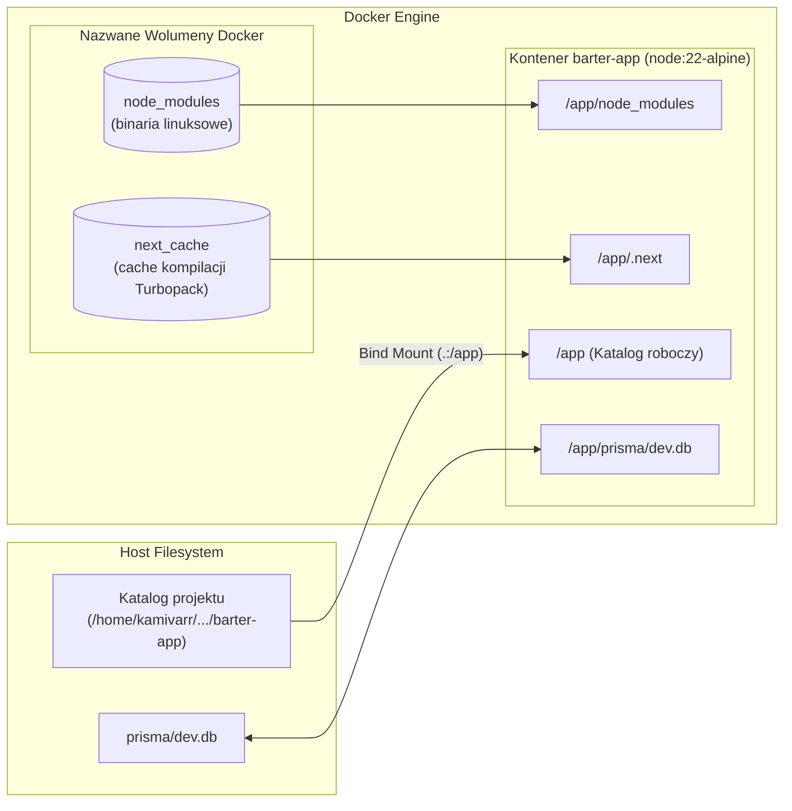
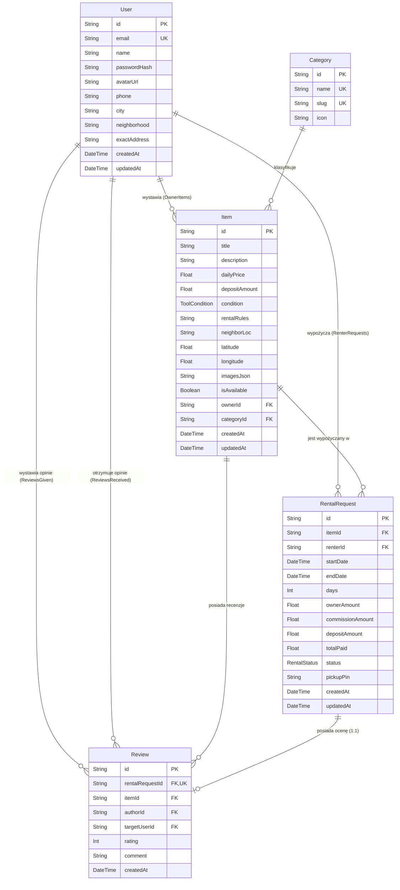
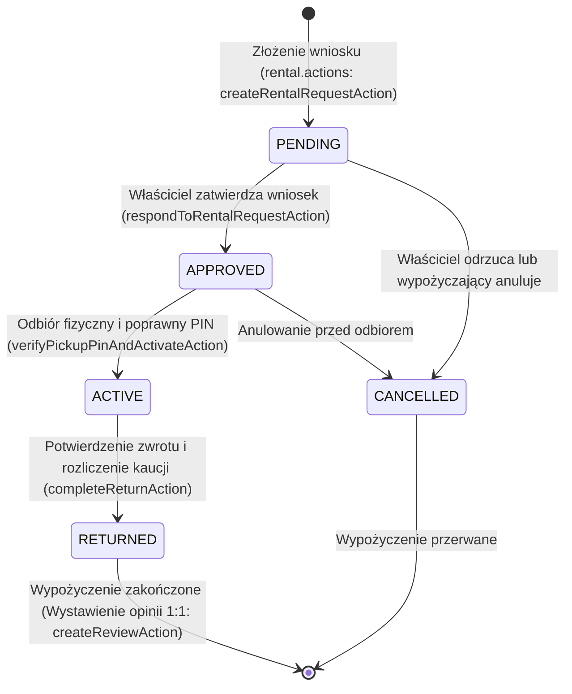
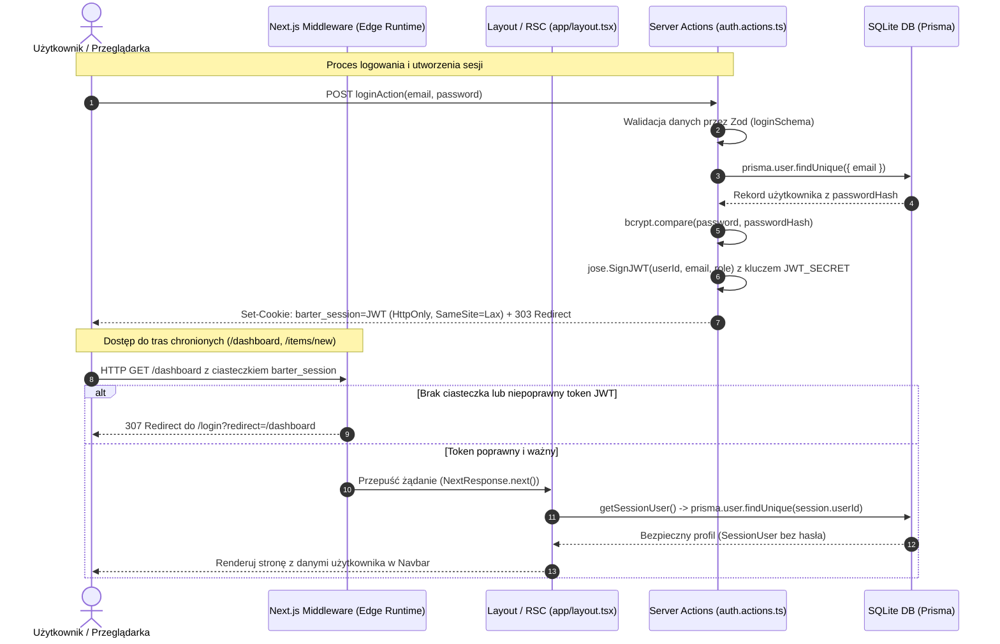
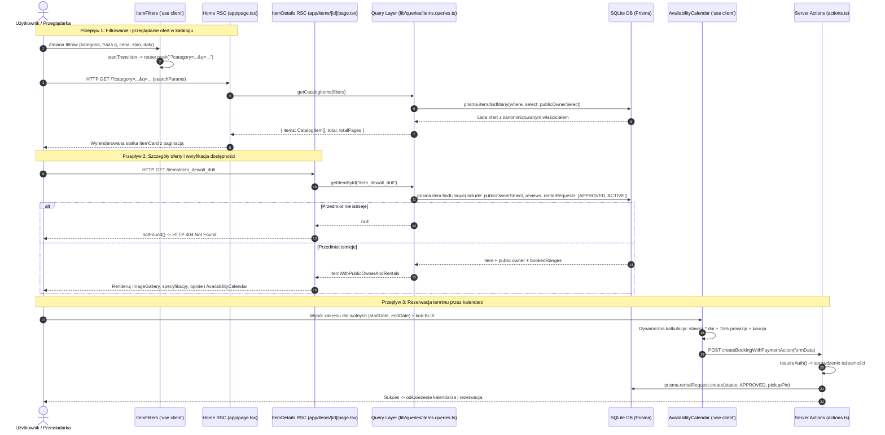

# Architektura Systemu: Barter App

Niniejszy dokument przedstawia całościową architekturę techniczną aplikacji **Barter**, mechanizmy konteneryzacji, środowisko Dev Containers, przepływ danych, model domenowy oraz maszynę stanów wypożyczeń.

---

## 1. Wysokopoziomowy diagram architektury

Aplikacja oparta jest na nowoczesnym modelu hybrydowym Next.js App Router (React Server Components + Server Actions):

---

## 2. Architektura kontenera i wolumenów Docker

W celu zapewnienia pełnej izolacji i niezależności od środowiska hosta, zastosowano architekturę wielowarstwową z dedykowanymi wolumenami:

### Kluczowe cechy rozwiązania:
1. **Izolacja zależności (`node_modules`):** Zależności skompilowane dla architektury kontenera (Alpine Linux / musl libc) nie kolidują z systemem plików hosta.
2. **Zachowanie danych SQLite:** Baza danych `prisma/dev.db` znajduje się w bind mountowanym katalogu `prisma/`, dzięki czemu wszystkie rekordy, migracje i zmiany są trwale zapisane bezpośrednio na dysku dewelopera.
3. **Uprawnienia użytkownika (`node` UID 1000):** Kontener nie działa z poziomu `root`, lecz wbudowanego użytkownika `node`, co eliminuje konieczność używania `sudo` do edycji plików na maszynach linuksowych.

---

## 3. Model domenowy (Entity-Relationship Diagram)

Baza danych SQLite zarządzana przez Prisma ORM realizuje następujący schemat relacyjny:

---

## 4. Maszyna stanów wypożyczenia (Rental Lifecycle)

Każde wypożyczenie przechodzi przez ścisłą maszynę stanów z walidacją reguł biznesowych:

### Mechanizm PIN i ochrona prywatności:
- Podczas tworzenia rezerwacji generowany jest 4-cyfrowy kod PIN (`pickupPin`).
- Dokładny adres właściciela (`exactAddress`), telefon oraz kod PIN są odsłaniane dla wypożyczającego **wyłącznie po zatwierdzeniu** (`APPROVED` lub `ACTIVE`).
- Przy przekazaniu sprzętu wypożyczający podaje PIN właścicielowi, a właściciel weryfikuje go w systemie, co atomowo przestawia stan na `ACTIVE`.

---

## 5. Modułowa architektura Server Actions

Wszystkie mutacje zostały podzielone na dedykowane moduły w katalogu `app/actions/`:
1. **`app/actions/item.actions.ts`:**
   - `createItemAction`: Walidacja Zod (`itemFormSchema`), weryfikacja tożsamości `requireAuth()`, utworzenie rekordu z galerią zdjęć w formacie JSON (`imagesJson`), unieważnienie cache.
   - `updateItemAction`: Weryfikacja właściciela (`item.ownerId === sessionUser.id`), w przeciwnym razie błąd autoryzacji `403 Forbidden`.
   - `toggleItemAvailabilityAction`: Błyskawiczne ukrywanie/odkrywanie ogłoszenia w katalogu.
2. **`app/actions/rental.actions.ts`:**
   - `createRentalRequestAction`: Weryfikacja kolizji terminów w transakcji `prisma.$transaction`, blokada samozamawiania, kalkulacja stawek i generowanie PIN.
   - `respondToRentalRequestAction`, `verifyPickupPinAndActivateAction`, `completeReturnAction`, `cancelRentalAsRenterAction`: Ścisła kontrola uprawnień i dozwolonych przejść maszyny stanów.
   - `createReviewAction`: Walidacja oceny 1–5 gwiazdek z wymuszeniem relacji 1:1.
   - `getUserDashboardDataAction`: Bezpieczna projekcja danych spersonalizowanych pod role Wypożyczającego i Właściciela z maskowaniem wrażliwych danych.
3. **`app/actions/auth.actions.ts`:**
   - Bezpieczne operacje uwierzytelniania (`loginAction`, `registerAction`, `logoutAction`).
4. Wszystkie eksportowane funkcje są asynchroniczne (`async`), a czyste funkcje pomocnicze odseparowane są w `types/domain.ts`.

---

## 6. Architektura uwierzytelniania i autoryzacji (Auth Flow)

System stosuje bezstanowe sesje oparte o podpisane kryptograficznie tokeny JWT przechowywane w ciasteczkach `HttpOnly` (`barter_session`), gwarantując bezpieczeństwo i brak wycieków danych do kodu JavaScript klienta.

### Kluczowe komponenty modułu bezpieczeństwa:
1. **`lib/auth.ts`:**
   - Podpisywanie tokenów JWT kluczem `JWT_SECRET` (HS256) za pomocą Web Crypto API (`jose`).
   - Ustawianie i usuwanie ciasteczka `barter_session` z flagami `HttpOnly`, `SameSite: 'lax'`, `path: '/'`, `maxAge: 7 dni`.
   - `getSessionUser()`: Asynchroniczny odczyt ciasteczka w Server Components i Server Actions, z weryfikacją podpisu i pobraniem aktualnych danych użytkownika z bazy.
   - `requireAuth()`: Strażnik blokujący operacje mutujące dla użytkowników niezalogowanych.
2. **`lib/validations/auth.ts`:**
   - Schematy Zod (`loginSchema`, `registerSchema`) zapewniające spójność walidacji formatu adresu email, minimalnej długości hasła (8 znaków) oraz danych profilowych (imię, osiedle, adres).
3. **`middleware.ts`:**
   - Strażnik tras brzegowych (Next.js Edge Middleware).
   - Weryfikuje token JWT w ułamkach milisekundy przy użyciu `jose.jwtVerify`, nie obciążając bazy danych ani silnika zapytań Prisma.
   - Chronione ścieżki: `/dashboard/:path*`, `/items/new`, `/items/:path*/edit`.
4. **Eliminacja hardcodowanych tożsamości:**
   - Wszelkie operacje dodawania przedmiotów (`createItemAction`) oraz rezerwacji wypożyczeń (`createBookingWithPaymentAction`) jednoznacznie odczytują tożsamość użytkownika z `sessionUser.id`.

---

## 7. Architektura modułu katalogu i eksploracji ofert (Marketplace Core)

Moduł eksploracji i katalogu ofert realizuje model marketplace wzorowany na platformach Vinted i OLX. Architektura łączy asynchroniczne React Server Components (RSC) dla optymalnego renderowania po stronie serwera z lekkimi Client Components (`'use client'`) odpowiadającymi za interaktywne filtry, galerię zdjęć oraz kalendarz rezerwacji.

### Kluczowe komponenty modułu Marketplace Core:

1. **Warstwa zapytań Prisma (`lib/queries/items.queries.ts`):**
   - **`getCatalogItems(filters)`:** Dynamiczne konstruowanie klauzuli `where` Prisma:
     - Wyszukiwanie wielopolowe (`OR: [title, description, neighborLoc]`),
     - Filtrowanie po kategorii (`category: { slug: categorySlug }`),
     - Widełki cenowe (`dailyPrice: { gte: minPrice, lte: maxPrice }`),
     - Stan techniczny (`condition`),
     - Dostępność w przedziale dat – wykluczenie nakładających się rezerwacji (`status IN ['APPROVED', 'ACTIVE']` oraz `startDate <= filterEnd AND endDate >= filterStart`).
     - Paginacja (`skip`, `take: pageSize`) i sortowanie.
   - **`getItemById(id)`:** Pobieranie pojedynczej oferty wraz z publicznym profilem właściciela, recenzjami sąsiedzkimi i zablokowanymi terminami rezerwacji.

2. **Ścisła izolacja danych wrażliwych właściciela (`publicOwnerSelect`):**
   - W celu ochrony prywatności mieszkańców, publiczne zapytania katalogowe oraz strona `/items/[id]` **bezwzględnie wykluczają** wrażliwe pola użytkownika:
     - `exactAddress` (dokładny adres z numerem mieszkania),
     - `phone` (numer telefonu),
     - `email` (adres poczty elektronicznej),
     - `passwordHash` (skrót hasła).
   - Publiczny selektor udostępnia wyłącznie: `id`, `name`, `neighborhood`, `avatarUrl`, `city`.

3. **Synchronizacja stanu filtrów z URL (`components/items/item-filters.tsx`):**
   - Komponent kliencki wykorzystujący `useSearchParams`, `useRouter`, `usePathname` oraz `useTransition`.
   - Każda zmiana filtra (kategoria, wyszukiwarka, suwak ceny, stan narzędzia, daty) natychmiast aktualizuje parametry URL, co umożliwia dzielenie się bezpośrednimi linkami do przefiltrowanych wyników i pełną obsługę przycisków wstecz/dalej przeglądarki.

4. **Kalendarz dostępności i rezerwacji (`components/items/availability-calendar.tsx`):**
   - Interaktywny kalendarz miesięczny z wizualizacją dni przeszłych i terminów zablokowanych (rezerwacje `APPROVED` lub `ACTIVE`).
   - Dynamiczne przeliczanie kwot:
     $$\text{ownerAmount} = \text{days} \times \text{dailyPrice}$$
     $$\text{commissionAmount} = \text{ownerAmount} \times 0.15$$
     $$\text{totalPaid} = \text{ownerAmount} + \text{commissionAmount} + \text{depositAmount}$$
   - Zabezpieczenie przed rezerwacją własnego przedmiotu (`isOwner`).
   - Zintegrowana płatność symulowana kodem BLIK delegująca operację do `createBookingWithPaymentAction`.

5. **Optymalizacja SSR i Next.js 16 Partial Prerendering:**
   - Strona katalogu [app/page.tsx](file:///home/kamivarr/Data/Projects/barter-app/app/page.tsx) korzysta z asynchronicznego pobierania danych w RSC opakowanego w `<Suspense fallback={<CatalogSkeleton />}>`.
   - Strona szczegółów [app/items/[id]/page.tsx](file:///home/kamivarr/Data/Projects/barter-app/app/items/[id]/page.tsx) definiuje `export const instant = false;`, co gwarantuje natychmiastowe zwrócenie nagłówka `HTTP 404 Not Found` dla błędnych identyfikatorów bez konfliktów z mechanizmem Partial Prerendering.
